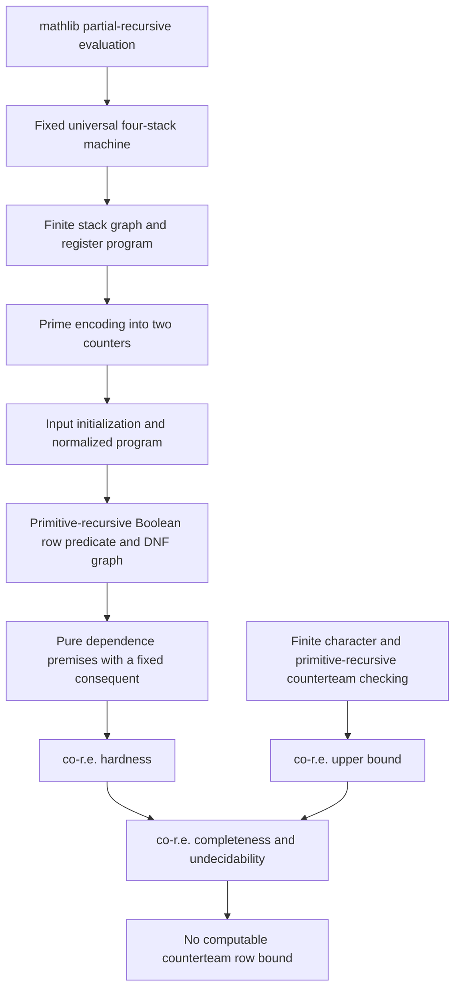

# Q1 formalization

This project accompanies the English [research note](../../../ai-tex/Q1/source.pdf).
It uses **Lean 4.35.0** and mathlib commit
`56a005855ea17e0b0958f73ec801ae140b0a1679`.

**The main theorem and the counterteam-size corollaries are fully proved.**
The formalization includes source universality, both directions of the
semantic reduction, and a primitive-recursive certificate for the
complete encoded reduction. No undecidability or compiler-correctness
hypothesis remains in the final theorems.

## Main theorem interfaces

[Complexity](Complexity.lean) assembles the exact classification:

```lean
Complexity.implication_coRE_complete :
  Complexity.CoREComplete Coded.Implication

Complexity.finite_implication_coRE_complete :
  Complexity.CoREComplete Coded.FiniteImplication
```

Here `CoREComplete P` means that the complement of `P` is `REPred` and
every co-r.e. predicate on natural numbers many-one reduces to `P` through
a mathlib `Computable` map. The module also gives explicit
`¬ ComputablePred` and `¬ REPred` results, both for general consequents
and for the fixed consequent.

The fixed consequent is literally

```text
=(w,z) ∨ =(w,z) ∨ =(U,w) ∨ =(U,w) ∨ =(V,w) ∨ =(V,w).
```

The variable names are `U=0`, `V=1`, `w=2`, and `z=3`. Repeated atom
occurrences are retained. Disjunction has lax cover semantics; cover
parts may overlap or be empty. Values range over arbitrary domains.

`fixed_hardness_restricted` carries both restrictions through the same
computable reduction: each premise is nonempty with at most five atom
occurrences, and every occurring variable except `0,1,2,4,5` has an
explicit bound of at most three values among the premises. The latter
condition includes variables mentioned in the consequent and is defined
as `FiveUnboundedColumns` in [ComplexityBounds](ComplexityBounds.lean).

[Compactness](Compactness.lean) proves
`finiteEntails_iff_entails`, so finite and arbitrary implication coincide.
[FinalModelBound](FinalModelBound.lean) connects undecidability to
counterteam sizes. The bound concerns the **number of rows in a
mathematical team**, not the size of an encoded search witness. For every
computable proposed bound, some invalid restricted instance requires
more rows in every finite counterteam, over every value domain.

## Correspondence with the TeX note (AI review)

Codex reviewed the [TeX note](../../../ai-tex/Q1/source.tex) against the
Lean definitions and main proof chain on 2026-10-25. The AI assessment
found no mismatch in the main theorem, its fixed consequent and syntactic
restrictions, or the counterteam-size corollary. It traced both directions
of the semantic reduction and the computability certificates. Human review
of the statement and proof correspondence remains pending.

The following differences delimit what is formalized:

- **Polynomial-size compilation is not formalized.** The TeX compilation
  lemma claims polynomial output size in the input Boolean circuit
  description. [CompilerBooleanInterface](CompilerBooleanInterface.lean)
  first represents row predicates by Shannon expansion. The final certified
  reduction uses explicit DNF in [BooleanDNF](BooleanDNF.lean) and
  [RawCompiler](RawCompiler.lean); [MachineRowVariant](MachineRowVariant.lean)
  proves that this change preserves the semantic reduction. Lean proves
  `RawCompiler.primrec_reduction` and `Complexity.primrec_reduction`, but no
  polynomial output-size or running-time bound. This suffices for the main
  theorem's computable many-one reductions; it does not certify every
  quantitative claim in the TeX compilation discussion.

- **The finite-character argument uses a different compactness interface.**
  The TeX proof introduces propositional variables and invokes propositional
  compactness. [Compactness](Compactness.lean) instead uses mathlib's Rado
  selection principle to combine finite row colourings. It proves the same
  finite-character statement and `finiteEntails_iff_entails`.

- **Source-machine hardness is expanded into a checked simulation chain.**
  The TeX note cites two-counter-machine halting and describes the required
  normalization. Lean starts from mathlib's partial-recursive evaluator,
  proves universality in [UniversalHardness](UniversalHardness.lean), and
  passes through stack and register machines to normalized two-counter
  programs. [UniversalCounterProgram](UniversalCounterProgram.lean) proves
  both the halting equivalence and primitive recursiveness of the varying
  input codes. The fixed machine and its finite label numbering may use
  classical choice; no undecidability or universality hypothesis remains
  in the final classification.

- **The input representation is slightly more general.** The TeX problem
  has nonempty disjunctions over the finitely many occurring variables and
  a finite set of premises. [CodedSyntax](CodedSyntax.lean) uses lists and
  natural-number variable names; its ambient syntax also admits empty
  disjunctions. [FiniteVariables](FiniteVariables.lean) proves finite-variable
  normalization. Premise repetitions do not affect `Models`, while repeated
  atom occurrences are retained by `Sat`. The hardness outputs have nonempty
  premises and the literal six-occurrence consequent, as checked by
  `Complexity.fixed_hardness_restricted`, so they lie in the TeX input
  language. Lean also quantifies over empty value types; with natural-number
  variables these supply only the empty team and do not change implication.

The central Hall saturation, control path, complete token matchings,
counter updates, three-marker compiler, and fixed-consequent argument
follow the TeX construction. In particular,
`SemanticMachine.Countermodel.halts` derives halting from the semantic
premises and target failure; it does not assume that the needed ports or
computation already exist. The converse constructs a finite counterteam
from a halting run. Finally, `SmallCounterteam` measures `Nat.card T`, so
the no-computable-bound result concerns the actual number of team rows,
as in the TeX corollary.

The library build and all 165 principal theorem axiom checks passed during
the import. This machine check and the AI correspondence assessment are
recorded separately from the two human-review status fields.

## Proof chain



| Layer | Principal modules |
| --- | --- |
| Team semantics and finite character | [Basic](Basic.lean), [Coloring](Coloring.lean), [Compactness](Compactness.lean), [Projection](Projection.lean), [FiniteVariables](FiniteVariables.lean) |
| Encoded upper bound | [CodedSyntax](CodedSyntax.lean), [CodedCheck](CodedCheck.lean), [CodedSemantics](CodedSemantics.lean), [Computability](Computability.lean) |
| Actual universal source | [UniversalTM2](UniversalTM2.lean), [UniversalInput](UniversalInput.lean), [UniversalHardness](UniversalHardness.lean), [TM2Renaming](TM2Renaming.lean) |
| Exact finite machine simulations | [TM2Microsteps](TM2Microsteps.lean), [TM2StackGraph](TM2StackGraph.lean), [StackNetwork](StackNetwork.lean), [RegisterCompiler](RegisterCompiler.lean), [TM2CounterReduction](TM2CounterReduction.lean) |
| Effective normalized source family | [ProgramNormalization](ProgramNormalization.lean), [NormalizationCoding](NormalizationCoding.lean), [UniversalCounterProgram](UniversalCounterProgram.lean) |
| Counterteam to halting run | [Hall](Hall.lean), [SemanticSaturation](SemanticSaturation.lean), [SaturatedPorts](SaturatedPorts.lean), [SemanticSoundness](SemanticSoundness.lean), [MachineExtraction](MachineExtraction.lean) |
| Halting run to finite counterteam | [TokenConstruction](TokenConstruction.lean), [CanonicalGraph](CanonicalGraph.lean), [CanonicalCountermodel](CanonicalCountermodel.lean), [MachineRealization](MachineRealization.lean) |
| Uniform dependence compiler | [CompilerSyntax](CompilerSyntax.lean), [CompilerSoundness](CompilerSoundness.lean), [CompilerCompleteness](CompilerCompleteness.lean), [MachineRowVariant](MachineRowVariant.lean) |
| Fully certified encoded compiler | [RawBooleanRows](RawBooleanRows.lean), [BooleanDNF](BooleanDNF.lean), [BooleanGraphCode](BooleanGraphCode.lean), [RawMachineTheory](RawMachineTheory.lean), [CompilerFrontend](CompilerFrontend.lean), [RawCompiler](RawCompiler.lean) |
| Quantitative counterteam normalization | [BoundedCounterteams](BoundedCounterteams.lean), [ModelBound](ModelBound.lean), [FinalModelBound](FinalModelBound.lean) |

The semantic reduction works in both directions: an arbitrary counterteam
forces a real halting run, and a halting run yields a finite counterteam.
The effective frontend uses an explicit DNF row formula.
`MachineRowVariant` proves that this choice preserves the semantics of
the earlier Shannon-based construction; the two syntactic outputs are
not identified.

## Computability and classical definitions

The universal program is selected from mathlib's proved representation
theorem. Its fixed finite instruction table and a fixed finite numbering
of its controls may use classical choice. They are constants in the
reduction; the varying input family has an explicit `Primrec` certificate.
No universality assumption is added. The project does not print or execute
the enormous selected universal instruction table.

Similarly, a few dependent internal definitions are marked `noncomputable`
to avoid unnecessary code generation. Computability claims are separate
proved statements using mathlib's `Primrec` and `Computable`, not conclusions
inferred merely from having written a Lean function.

## Build and audit

```sh
# From the repository root:
(cd lean && lake exe cache get)
./scripts/check.sh
```

The script builds the entire library with warnings treated as errors,
then checks the axiom dependencies of the principal results in
[Check.lean](../../Check.lean). It accepts only `propext`, `Classical.choice`, and
`Quot.sound`. There are no `sorry`, `admit`, custom axioms, or
`native_decide` proofs. Finite gadget checks use kernel-checked `decide`.

The build writes its audit to `build/lean-check.log`. The shared Lean project
pins its toolchain and dependencies in `lean/lean-toolchain`,
`lean/lakefile.toml`, and `lean/lake-manifest.json`. Dependency caches and
build products are ignored by Git.

Import this formalization with `import DepDis.Q1` or a specific
`DepDis.Q1` module. Declaration names retain their original `DepDis`
namespaces. The source proofs were imported with only module paths
adjusted to the shared repository layout.
